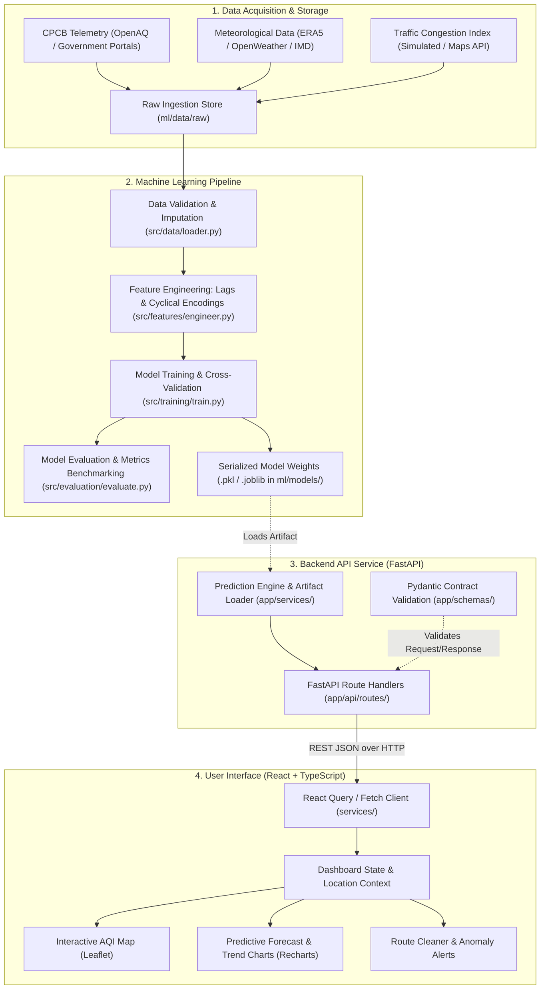

# EcoPredict — System Architecture & Data Flow

This document details the proposed end-to-end system architecture, service responsibilities, data flow, and interface contracts for **EcoPredict**, an AI-powered air-quality intelligence and AQI forecasting platform.

> [!NOTE]
> **Project Phase: Checkpoint 1 (Project Foundation)**  
> This architecture represents the target design established for the hackathon. Component contracts and directory scaffolding are implemented in this checkpoint, with static preview data used on the frontend. Full data pipelines, automated training runs, and live external APIs will be connected in subsequent checkpoints.

---

## 1. High-Level Architecture Diagram



---

## 2. Layer Responsibilities & Data Flow

### Step 1 — Data Sources
* **Responsibilities**: Ingest historical and real-time environmental metrics from ambient telemetry stations and meteorological services.
* **Key Providers**:
  - **Ambient Air Stations**: OpenAQ API, Central Pollution Control Board (CPCB) open feeds.
  - **Weather Metrics**: Temperature, relative humidity, wind speed, wind direction, boundary layer height, and atmospheric pressure.
  - **Traffic / Satellite Proxies**: Fire radiative power (stubble burning detection) and vehicular congestion indices.
* **Expected Output**: Raw tabular records (`CSV` or `JSON` feeds) stored in `ml/data/raw/`.

---

### Step 2 — Data Validation & Preprocessing
* **Responsibilities**: Clean sensor readings, handle sensor dropouts, eliminate anomalous physical spikes, and standardize time intervals.
* **Component**: `ml/src/data/loader.py`
* **Operations**:
  - Timestamp alignment to continuous 1-hour intervals.
  - Outlier detection (e.g., negative pollutant concentrations or physically impossible readings).
  - Forward-fill or spline imputation for short sensor outages (< 3 hours).
* **Inputs**: Raw CSV records.
* **Outputs**: Cleaned, imputed dataframe written to `ml/data/processed/`.

---

### Step 3 — Feature Engineering
* **Responsibilities**: Transform raw time-stamped concentrations into predictive features that capture diurnal trends and meteorology.
* **Component**: `ml/src/features/engineer.py`
* **Features Generated**:
  - **Lagged Pollutants**: $t-1$, $t-3$, $t-6$, $t-12$, and $t-24$ hour concentrations for $PM_{2.5}$ and $PM_{10}$.
  - **Rolling Statistics**: 3-hour, 6-hour, and 24-hour moving averages and standard deviations.
  - **Temporal Periodicity**: Sine and cosine cyclical encodings for hour-of-day ($0-23$) and day-of-week ($0-6$).
  - **Meteorological Interactions**: Ventilation index ($\text{Wind Speed} \times \text{PBL Height}$), temperature inversions, and wind vector components ($u, v$).
* **Inputs**: Cleaned sensor time series.
* **Outputs**: Model-ready feature matrix ($X, y$).

---

### Step 4 — Model Training & Evaluation
* **Responsibilities**: Fit supervised regression models, evaluate forecast skill against persistence baselines, and benchmark generalization errors.
* **Components**:
  - `ml/src/training/train.py`
  - `ml/src/evaluation/evaluate.py`
* **Algorithms Considered**:
  - Baseline: Persistence Model ($AQI_{t+k} = AQI_t$) & Ridge Regression.
  - Primary Model: Random Forest Regressor & LightGBM / XGBoost for tabular time-lag features.
  - Multi-Horizon Forecasting: Separate model heads or recursive forecasting for $+1\text{h}$ to $+24\text{h}$.
* **Evaluation Metrics**:
  - Mean Absolute Error (MAE)
  - Root Mean Squared Error (RMSE)
  - Symmetric Mean Absolute Percentage Error (sMAPE)
  - Directional Accuracy (% of correct category shifts)
* **Outputs**:
  - Evaluation summary reports (`ml/reports/metrics.json`).
  - Serialized model pipeline artifact (`ml/models/aqi_forecast_model.pkl`).

---

### Step 5 — Saved Model Artifact
* **Responsibilities**: Package model weights, feature transformers, and target scalers into a production artifact that can be loaded into memory without retraining.
* **Path**: `ml/models/` (ignored by Git to prevent repository bloat).
* **Format**: Python `joblib` or ONNX format with versioning metadata.

---

### Step 6 — FastAPI Prediction Endpoints
* **Responsibilities**: Provide lightweight, low-latency REST endpoints for frontend consumption with strict Pydantic contract validation and CORS security.
* **Component**: `backend/app/main.py`, `backend/app/api/routes/`
* **Key Endpoints**:
  - `GET /api/health`: Service health, uptime, and checkpoint version status.
  - `GET /api/aqi/summary?location={city}`: Current AQI value, primary pollutant, health advice, and hour-over-hour delta.
  - `GET /api/aqi/stations`: Geospatial station list with coordinates and real-time status.
  - `GET /api/aqi/forecast?location={city}&horizon=24`: Hourly predicted AQI with lower and upper confidence intervals.
  - `POST /api/routes/exposure`: Receives start and end coordinates, computes pollution exposure across route candidates, and returns the lowest-inhalation route.
* **Inputs**: HTTP GET/POST queries with JSON bodies.
* **Outputs**: JSON responses adhering to `app/schemas/aqi.py`.

---

### Step 7 — React Dashboard
* **Responsibilities**: Render an accessible, data-dense interface allowing citizens, vulnerable individuals, and city planners to interpret ambient air health and forecasts.
* **Component**: `frontend/src/`
* **Key Views**:
  - **Executive KPI Cards**: Real-time AQI number, severity category tag, 12h forecast preview, primary pollutant concentration, and health guidance.
  - **Interactive Leaflet Map**: Geo-referenced station points with color-coded severity circles and hotspot dispersion buffers.
  - **Forecast Horizon Area Chart**: 24-hour forward projection with confidence bands and threshold alerts.
  - **Historical Telemetry Chart**: 24-hour retrospective particulate trend comparison.
  - **Pollutant Metric Grid**: Individual breakdown for $PM_{2.5}, PM_{10}, NO_2, SO_2, CO, O_3$.
  - **Clean Route Exposure Planner**: Prototype comparative exposure planner between origins and destinations.

---

### Step 8 — User-Facing Insights & Actionable Guidance
* **Responsibilities**: Convert raw numeric values into human-actionable preventive steps:
  - Masks recommendations (N95 advice when $PM_{2.5} > 90\,\mu\text{g/m}^3$).
  - Vulnerable group alerts (pediatric, geriatric, and asthmatic advisories).
  - Transit timing suggestions (avoid outdoor workouts during morning temperature inversion spikes).

---

## 3. Frontend-to-Backend Communication Contract

```
[ Frontend (React :5173) ]
          │
          ├── (1) GET /api/aqi/summary?location=Delhi
          │   └── Returns: { aqi: 234, category: "Poor", ... }
          │
          ├── (2) GET /api/aqi/stations
          │   └── Returns: { stations: [ { id, name, lat, lng, aqi } ] }
          │
          ├── (3) GET /api/aqi/forecast?hours=24
          │   └── Returns: { forecast: [ { time, predictedAqi, ... } ] }
          │
          └── (4) POST /api/routes/calculate
              └── Body: { start: "Connaught Place", dest: "Okhla" }
                  Returns: { recommendedRoute, exposureReductionPct }
```

### Communication Principles:
1. **REST over HTTP/HTTPS**: JSON payloads with standard HTTP status codes (`200 OK`, `400 Bad Request`, `422 Validation Error`, `500 Internal Error`).
2. **CORS Safe**: Backend explicitly whitelists Vite development origin (`http://localhost:5173`).
3. **Decoupled Architecture**: The frontend can operate seamlessly using local mock service data when offline, allowing frontend developers and backend/ML developers to iterate concurrently without blocking each other.
